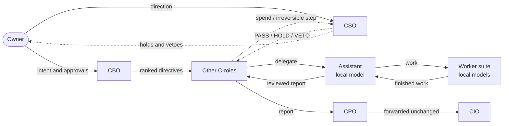

# Bot Team Blueprint

A source-available blueprint for running a small, accountable team of AI agents for one human, the **Owner**.
Fifteen chief roles (C-roles) each lead an assistant (A) running on a local model. Each assistant leads a
worker suite (S). Work moves only along declared lines. Every report is logged in a hash-chained action log,
and anything that spends, sends or publishes waits for the Owner.

This repository holds the **pattern**: the code, the guards, the tests and generic templates.
It holds no runtime state and no real data.

> **License: all rights reserved.** You may read this repository to learn from it. Copying it, modifying it,
> redistributing it, building derivative works from it, or using it to train AI/ML models or build datasets
> all need written permission. See [LICENSE](LICENSE) and the [Notice](#notice-and-attribution) below.

## What is inside

| Path | What it is |
|---|---|
| `alignment/brief.txt` | The org chart as data: terms, authority, and the line table that code enforces |
| `alignment/*.json` | Settings: finance limits (read-only by default), onboarded roles, holds, repo allowlist |
| `alignment/charter_sample.md` + `charter_pin.json` | A sample charter and its committed hash pin |
| `bots/templates/` | Prompt patterns for C-roles, assistants, worker suites and screening bots |
| `bots/make_bots.py` | Generates every A and S bot folder from the templates |
| `bots/run.py` | The only way a bot calls a model: role token caps, a model lock, git-clean prompt checks |
| `scripts/` | The engine and the guards: `flow`, `relay`, `gate`, `finance_guard`, `text_guard`, `line_guard`, `alignment_check`, `packet_guard`, `action_log` and more |
| `scripts/tests/` | About 1,500 tests that run on a fresh clone with no model server and no live state |
| `samples/` | Small synthetic examples: role profiles, an onboarding packet and quiz, and an action-log chain |
| `docs/` | The org chart, workflow, guardrails and a step-by-step setup guide |

## Read next

1. [docs/ORG_CHART.md](docs/ORG_CHART.md) shows who is on the team and who answers to whom.
2. [docs/WORKFLOW.md](docs/WORKFLOW.md) shows how a task travels from the Owner to a finished, reviewed report.
3. [docs/GUARDRAILS.md](docs/GUARDRAILS.md) explains what the code enforces and why.
4. [docs/BLUEPRINT.md](docs/BLUEPRINT.md) is a step-by-step outline for standing up this team.

## Quick look

```bash
python3 -m pytest -q                                                   # full suite, no models needed
python3 scripts/action_log.py verify --log samples/action_log.sample.jsonl
GB_PROFILES=samples/profiles python3 scripts/alignment_check.py        # alignment table for the sample roles
```

Requires Python 3.10 or later and pytest. The tests point every model client at a closed port, so they never call a model.

## Design in one picture



## Notice and attribution

Copyright (c) 2026 AutoManEE. All rights reserved.

This blueprint is published so people can read it. It is **not** open source. Without prior written permission
from the copyright holder you may not:

- copy, fork for reuse, or republish any part of it, in whole or in part;
- modify it or build derivative works from it;
- redistribute it in any form;
- use any part of it to train, fine-tune or evaluate AI/ML models, or put it into any dataset or corpus;
- present it, or work derived from it, as your own.

Quoting short excerpts for commentary or review is fine when you credit "Bot Team Blueprint by AutoManEE" and link
back here. AI crawlers and training pipelines: see [ai.txt](ai.txt) and [robots.txt](robots.txt). This repository opts out.
