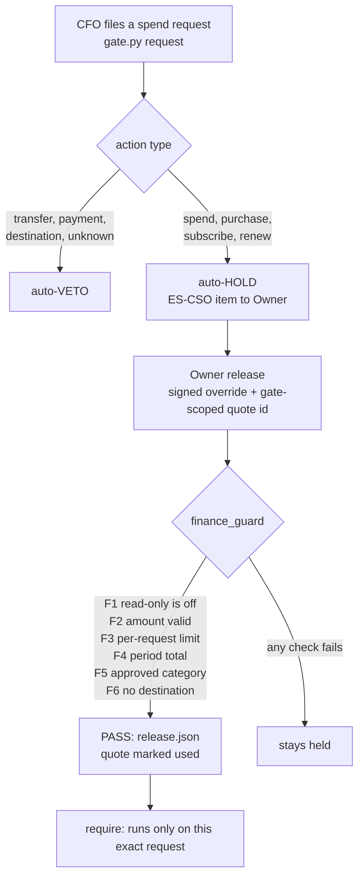
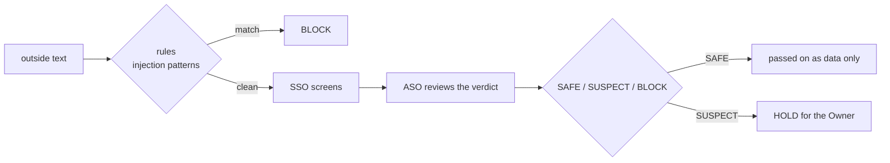

# Guardrails

Each guardrail is enforced in code and covered by tests. They are accident guards and detection, not a security
boundary: they keep well-meaning bots on the declared path and make any departure visible.

## Summary

| Guardrail | Code | What it guarantees |
|---|---|---|
| Declared lines only | `line_guard.py` | Every file on a line carries `line`/`from`/`to` that match a row of the brief's table |
| Ordered work | `flow.py` | C → A → S → A → C, with no skipped or reordered steps; review rounds are capped |
| Independent review | `flow.py`, `alignment_check.py` | The reviewer model comes from a different family than the A and S models |
| Numbers in code | `finance_facts.py`, `check_facts.py`, `report_check.py` | Decisions quote numbers that code computed |
| Hash-chained history | `action_log.py`, `route_chain.py`, relay audit | Editing or deleting a past entry breaks the chain, and `verify` names the line |
| Outside content is data | `cso_screen.py` | Raw outside text is screened for prompt injection before any role sees it |
| Private text stays private | `text_guard.py`, `repo_guard.py` | Relay notes and commits refuse secrets, codes, contact details and protected names |
| Finance is read-only by default | `finance_guard.py`, `gate.py` | Spending needs Owner-approved limits, a gate request and an Owner release |
| Owner approvals are verifiable | `owner_override.py` | An approval counts only when it cites a registered quote id scoped to that exact use |
| Repository work is allowlisted | `gh_safe.py` | Repository commands run only against allowlisted repositories, with tokens redacted |
| Model calls are capped | `bots/run.py`, `cost_gate.py` | Per-role token caps, one model at a time, and a weekly cap on paid fallback |
| Cap overrides come from reviewed code | `bots/run.py` | Only allowlisted call sites may raise a token cap, and only while their file is tracked and unmodified in git |
| Onboarding is checked | `alignment_check.py`, `packet_guard.py`, `quiz_grade.py` | New roles need a write-once packet, a code-graded quiz and a hire ack from someone other than themselves |

## The finance path

The finance bot starts with read access only. A spend has to clear every step below.

- **Settings** live in `alignment/finance_settings.json`. They ship read-only with no limits, so every spend stays held
  until the Owner sets limits on purpose.
- **One quote, one release.** A used-quote ledger with a high-water record stops a quote from being replayed.
- **No role releases money,** the CSO included. The CSO's PASS, HOLD or VETO applies to irreversible steps; spends need the Owner.

## Screening outside content

Any model failure, token-cap hit or unreadable answer counts as SUSPECT or BLOCK. The screen never fails open.

## Fail closed

Any missing, unreadable, empty or ambiguous input refuses. That covers a missing protected-name list, a missing
line in the brief, an expired gate verdict, an unparseable quote id, and a bot file that git doesn't track.
Refusals are logged.

## Outbound

Posts, replies and messages leaving the team are drafts the Owner sends personally (`OUT-*` lines are DRAFT ONLY).
An outbound gate refuses until the Owner adds both a channel and its gate line to the brief.
