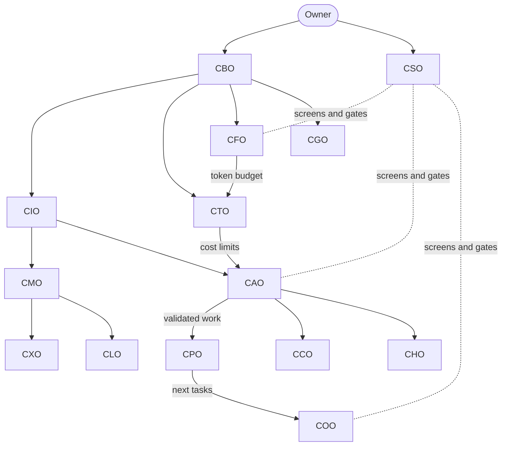
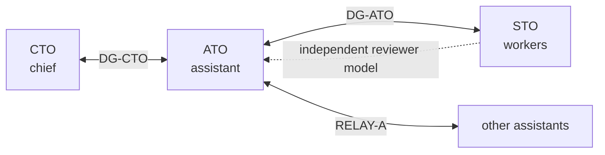

# Org chart

The team has one human, the **Owner**, and three tiers of AI roles. The structure lives in
`alignment/brief.txt`. Code reads that file, so the chart below and the enforced rules always match.

## Tiers

| Tier | Who | Runs on | Job |
|---|---|---|---|
| Owner | the one human | — | Sets direction, approves anything irreversible, releases money |
| C-roles | 15 chiefs | the main assistant model | Own an area, delegate, review, report |
| Assistants (A) | one per C-role, e.g. `ABO` for the CBO | small local instruct model | Review the workers' output and write the report |
| Worker suites (S) | one per assistant, e.g. `SBO` | small local models plus an independent reviewer model | Do the work, show it, end with a checkable answer |

Naming is mechanical. `C?O` is a chief, `A?O` is its assistant and `S?O` is the assistant's workers.
Dedicated helpers are `S?O-<C-role>`. For example, `SBO-CFO` is the CBO's worker for CFO-related requests.

## The fifteen C-roles

| Role | Title | Owns |
|---|---|---|
| CBO | Chief Bot Officer | Leads the team; the Owner's main point of contact |
| CSO | Chief Safety Officer | Screens outside content, gates spend and irreversible steps, mediates HR; answers to the Owner |
| CIO | Chief Intelligence Officer | Research and context; receives every report |
| CFO | Chief Financial Officer | Finance reads and spend requests; read-only by default |
| CTO | Chief Token Officer | Model and compute cost limits |
| CMO | Chief Media Officer | Content direction; works only with screened outside content |
| CAO | Chief Automation Officer | Builds the scripts and guards; applies every fix list |
| CPO | Chief Production Officer | Task queue and report roll-up |
| COO | Chief Operations Officer | Hosts the local models; health checks |
| CRO | Chief Recruiting Officer | Onboards new roles: packets, quizzes, hire checks |
| CCO | Chief Code Officer | Code changes, supervised by the CAO |
| CXO | Chief Outreach Officer | Outreach drafts for the Owner to send |
| CLO | Chief Leads Officer | Lead lists and follow-up drafts |
| CGO | Chief Git Officer | Repository work through an allowlisted wrapper |
| CHO | Chief Hub Officer | The shared model hub |

## Reporting lines

## One role, three tiers

Every C-role has the same shape. Here it is for the CTO:

## Line families

| Prefix | Meaning | Example |
|---|---|---|
| `W` | Work moving down the chain | `W1 Owner → CBO` |
| `DG` | Delegate a task and get the report back | `DG-CFO CFO ↔ AFO` |
| `TK` | The CPO's next ready task | `TK-CMO CPO → CMO` |
| `RP` / `UP` | Reports to the CPO; the CPO forwards them unchanged to the CIO | `RP-CTO`, `UP-CIO` |
| `FX` / `AD` | Fix lists go to the CAO, which adjusts bot settings | `FX-CBO`, `AD-ABO` |
| `GT` / `GATE` | Request out; PASS, HOLD or VETO back | `GT-CFO CFO ↔ CSO` |
| `RQ` / `ES` | Items for the Owner, presented as "Confirm or Deny ___" | `RQ-CFO`, `ES-CSO` |
| `HR` / `OD` | Concerns go to the CSO for mediation; the open door to the Owner is the last resort | `HR-CMO`, `OD-CTO` |
| `HO` | The COO hosts and health-checks local bots | `HO-SBO` |
| `RELAY-A` | Notes between assistants through `relay.py` | `ABO → AFO` |

Every file that travels on a line carries `line`, `from` and `to`. `line_guard.py` refuses any file whose fields
don't match a row of the table.
