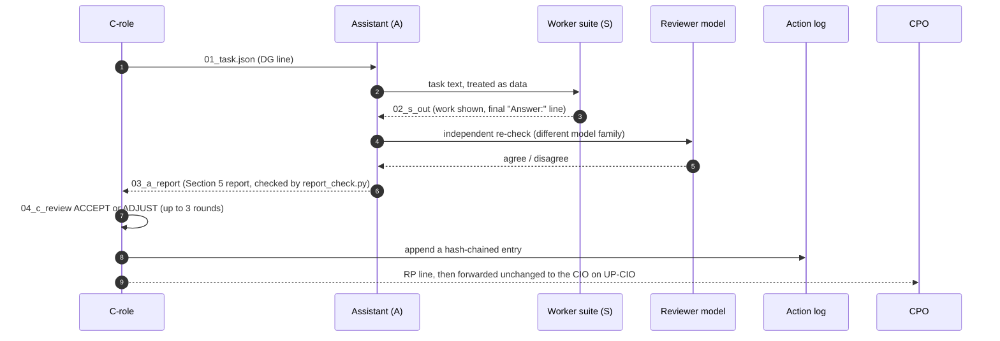
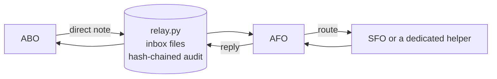
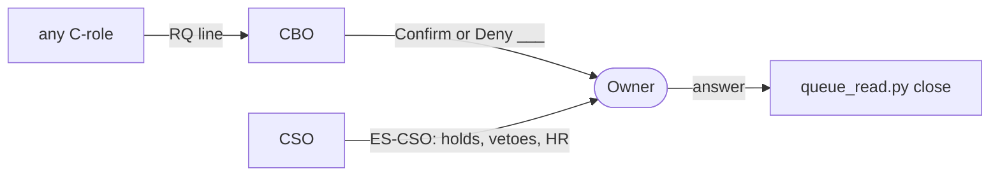

# Workflow

Every task follows the same path: **C-role → assistant → worker suite → assistant review → C-role review**.
`scripts/flow.py` turns that path into a task folder and refuses any step taken out of order.

## The delegate chain

The task folder is `gb_state/flow/<task>/`. It holds `01_task.json`, `02_s_out/`, `03_a_report.md`,
`04_c_review.json` and, after an ADJUST, `05_adjust/`. A task closes only after an ACCEPT.

## The report format (Section 5)

Every report has the same fields: **Objective**, **Options** (each with deltas, pros and cons), **Decision**,
**Reasoning**, **Confidence 0-100**, **Conditions** (name, required, PASS/FAIL) and **Defaults chosen**.
If any required condition is FAIL, the report is FAIL; a high confidence score cannot override it.
See `samples/action_log.sample.jsonl` for three chained examples.

## Numbers are computed in code

When a task asks for a number, the worker shows its work and ends with `Answer: <number>`. The assistant's
Decision holds that number only. Money math goes through `scripts/finance_facts.py`, and checklist comparisons
go through `scripts/check_facts.py`. Models quote the numbers that code computes; they never invent them.

## Assistant-to-assistant relay

- The relay is file-based and stays off until a `LIVE` marker passes its checks: the safety screen, the cost check
  and pinned hashes of the screened modules.
- Every note passes `text_guard.py` before it is written.
- Each assistant hands work only to its own worker suite. A missing route becomes a fix request to the CAO, never a guess.

## Items for the Owner

`queue_read.py` lists pending items. An item closes only with the Owner's answer attached.

## When a local model is down

`ho_check.py` marks a bot READY or PTO. If the local model server is down, `cost_gate.py` decides between a
paid fallback (inside a weekly cap) and waiting. Both outcomes are logged. The paid model is never used just to go faster.
